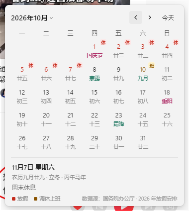
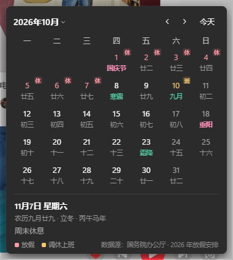

# 节假日日历（休 / 班）




一个 Windows 11 风格的日历弹窗：**直接标出法定节假日放假（休）与调休补班（班）**。
系统自带的日历只把放假日期标成红色，看不出哪天要调休上班——这个项目补上了这块缺失，
并且**接管任务栏时钟的点击**，让右下角时间弹出的就是它自己。

数据取自国务院办公厅放假通知，目前收录 2026、2027 两年。

## 功能特性

- **休 / 班标记**：红色 `休` = 放假，琥珀色 `班` = 调休上班，做成小角标挂在日期格子右上角，不占一行
- **农历与节日**：农历日、干支生肖、24 节气、农历节日（除夕、元宵、七夕、中秋、重阳……）、公历节日（含母亲节等浮动节日），全部内置离线可用
- **接管任务栏时钟**：点任务栏右下角时间弹出本日历；支持多屏、自动隐藏任务栏；点击窗口外自动收起
- **三级视图**：月历 → 月份视图 → 年份视图，点左上角标题逐级切换，和系统日历操作习惯一致
- **窗口形态**：原生风格深浅色跟随系统；高度随视图自适应；常驻托盘；`Ctrl + Alt + C` 全局热键
- **免运行时分发**：打包成安装版 / 绿色版 exe，对方不用装 Node、Python 或任何运行时

## 下载安装

到 [Releases](../../releases) 下载（或自行 `npm run dist` 打包）：

| 文件 | 说明 |
| --- | --- |
| `节假日日历-安装版-x.x.x.exe` | 安装向导，可选安装位置，创建桌面 / 开始菜单快捷方式 |
| `节假日日历-免安装-x.x.x.exe` | 绿色版，双击即用，不进「应用和功能」列表 |

系统要求：Windows 10 1809+ / Windows 11，64 位。

> 项目没有代码签名证书，首次运行 Windows 可能弹「Windows 已保护你的电脑」，
> 点 **更多信息 → 仍要运行** 即可，之后不再提示。

## 使用

| 操作 | 说明 |
| --- | --- |
| 点任务栏右下角的时间 | 打开 / 收起本日历（替代系统自带弹窗） |
| `Ctrl + Alt + C` | 呼出 / 收起日历 |
| 左键点托盘图标 | 呼出 / 收起日历 |
| 右键点托盘图标 | 开机自动启动 / 开关「接管任务栏时钟」/ 退出 |
| 鼠标滚轮、`←` `→` | 切上 / 下个月（月份、年份视图里为切年 / 切十年） |
| 点左上角标题 | 月历 → 月份视图 → 年份视图，三档循环 |
| `Esc` 或点击窗口外 | 逐级退回；月历下则收起窗口 |

点任意日期，下方显示农历全称（含干支生肖）、放假说明，可跳转国务院通知原文。

## 制作逻辑

### 为什么做

Windows 11 的系统日历（Shell 里那块 XAML 面板）由 explorer 渲染、受 WRP（Windows
Resource Protection）保护，**没有给第三方留任何节假日扩展点**——改不了它的显示内容，
也没有注册表或 API 能往里塞「班」字。所以思路只能是绕过渲染层、**接管交互层**：
在用户点时钟的那一刻，把点击拦下来，弹自己的日历。

### 整体架构

```
┌─ Electron 主进程 main.js ─────────────────────────┐
│  窗口管理（三级视图高度自适应 / 右下角锚定 / 多屏）    │
│  托盘 · 全局热键 · 配置持久化 config.json            │
│  └─ 启动钩子 hook.js（koffi FFI）                   │
│       WH_MOUSE_LL 全局鼠标钩子                       │
│       ├─ 命中时钟热区 → 吞掉点击 → 弹日历             │
│       └─ 命中日历窗口外 → 放行点击 → 通知收起          │
├─ 渲染进程 index.html + app.js ────────────────────┤
│  日历状态机（day / month / year 三档）               │
│  农历换算 vendor/solarlunar（1900–2100 内置离线）    │
│  节日三层优先级：节气 > 农历节日 > 公历节日 > 农历日   │
│  假期数据 data.js（唯一数据源，加年份不用改代码）      │
└───────────────────────────────────────────────────┘
```

### 关键决策一：用低级鼠标钩子，而不是透明窗口

最早的方案是在时钟上方盖一个透明窗拦截点击，**失败了**：

1. 任务栏每次自动隐藏升起，都会把自己重新顶到 z-order 最上层，覆盖窗抢不过；
2. 透明窗在部分机器上 `isVisible()` 为真却根本不绘制；
3. 自动隐藏任务栏升起前后 workArea 不变，靠它算位置会算错。

最终方案：`hook.js` 通过 koffi（预编译 FFI 库，**不需要编译工具链**）调
`SetWindowsHookExW(WH_MOUSE_LL)` 装一个全局低级鼠标钩子。钩子在系统分发点击
**之前**就拿到事件，没有 z-order 问题、不注入 explorer、不改系统文件、不需要
管理员权限。命中时钟热区时钩子回调 `return 1` 把这次点击吞掉，同时通知主进程弹日历。

代价也很清楚：钩子是进程级的全局资源，应用退出前必须 `UnhookWindowsHookEx`；
回调里绝不能做重活（详见下文「健壮性设计」）。

### 关键决策二：时钟热区的判定

「用户点了时钟」没有直接的系统事件，只能用几何判定，这里有三层：

1. **横向**：落点在屏幕右边缘 132px 内（时钟区域宽度）；
2. **纵向**：必须真的落在任务栏矩形内——只看横向是不够的，任务栏升起的一瞬间，
   最大化窗口右上角的关闭按钮也满足「靠右边」，会被误吞；
3. **任务栏是否升起**：自动隐藏的任务栏并没有变矮，只是被推到屏幕下方
   （实测隐藏时露出 2px、升起时露出 48px），所以用「露在屏幕内的像素高度 ≥ 20」判定。
   多屏时每块屏按**自己的**任务栏矩形算，枚举 `Shell_TrayWnd` 与所有
   `Shell_SecondaryTrayWnd`。

### 关键决策三：点击窗口外收起，不靠 blur

面板弹出时 Electron 窗口未必抢得到前台焦点——没有焦点就永远不会触发 `blur`，
表现就是「点了外面没反应」。所以主判据也在钩子里：主进程把日历窗口句柄
（`win.getNativeWindowHandle()`）交给钩子，每次鼠标按下时用 `GetWindowRect` +
`IsWindowVisible` **实时**取矩形判断落点；在窗口外就通知收起，**这一次点击不吞**，
开始菜单、其他程序照常响应。矩形每次实时取，多屏、改分辨率、切视图改高度都无需重新同步。
`blur` 只留作兜底。

### 健壮性设计

- **钩子回调不做重活**：低级钩子受 `LowLevelHooksTimeout` 限制，回调里同步调
  `show()/hide()` 一旦超时，Windows 会把钩子从链上摘掉、之后再也收不到点击。
  窗口操作一律 `setImmediate` 丢到下一个 tick，回调本身立刻返回；
- **钩子装不上不崩**：降级为只有热键和托盘可用，原因写进日志；
- **配置容错**：`config.json`（记住「接管」开关状态）带 BOM 或损坏都能正确读取，
  读不出来按默认值处理；
- **农历越界保护**：1900–2100 之外的日期不做农历换算，避免崩溃。

### 节日显示的优先级

一格只显示一行农历，按优先级取第一个命中的：
**节气 > 农历节日 > 公历节日 > 初一月份名 > 农历日**。
除夕没有固定农历日名，按「次日为正月初一」倒推；闰月不重复过节日；
浮动公历节日（母亲节、父亲节、感恩节）按「第 n 个星期 w」推算，不用每年维护。

### 打包与分发

`npm run dist` 走 electron-builder：NSIS 安装版 + portable 绿色版双产物。
运行时依赖只有 koffi 一个（FFI），其余全部是纯 JS；asar 内打包源码，
koffi 的原生模块 `asarUnpack` 出来保证可加载。国内网络打包时设置
`ELECTRON_MIRROR` 与 `ELECTRON_BUILDER_BINARIES_MIRROR` 镜像即可。

## 开发调试

```
npm install
npm start          # 或双击 启动日历.cmd
npm run dist       # 打包
```

调试环境变量：`HOLIDAY_AUTOSHOW=1` 启动后自动弹一次面板；
`HOLIDAY_THEME=light|dark` 强制深浅主题。
日志在 `%APPDATA%\节假日日历\logs\hook.log`（钩子安装、截获、收起事件都在里面）。

## 数据更新

`data.js` 是唯一的假期数据文件，明年通知发布后往里加一个年份数组即可，不用改代码：

```js
window.HOLIDAYS = {
  "2027": [
    { "name": "春节", "start": "2027-02-05", "end": "2027-02-13",
      "comp": ["2027-01-31", "2027-02-14"],      // comp = 调休补班日
      "memo": "……", "url": "https://www.gov.cn/…" }
  ]
};
```

## 已知局限

- 未购买代码签名证书，首次运行会有 SmartScreen 提示；
- Win11 副屏任务栏默认不显示时钟，但点击那块区域也会弹出日历（可在托盘里关掉整个接管）；
- 任务栏被移到屏幕左侧或右侧（竖排）时，接管自动失效——只处理底部横向任务栏；
- 2028 年及以后显示「未收录」，需要按上面格式补充数据。

## 目录结构

```
main.js        主进程：窗口、托盘、热键、配置、钩子生命周期
hook.js        koffi FFI 全局鼠标钩子（时钟截获 + 窗口外监视）
preload.js     渲染进程桥（高度自适应 IPC）
index.html / app.js / style.css   渲染层：三级视图与农历节日
data.js        假期数据（2026–2027）
vendor/        solarlunar 农历库（1900–2100，离线内置）
assets/        应用图标、托盘图标
启动日历.cmd    开发模式启动脚本
```
